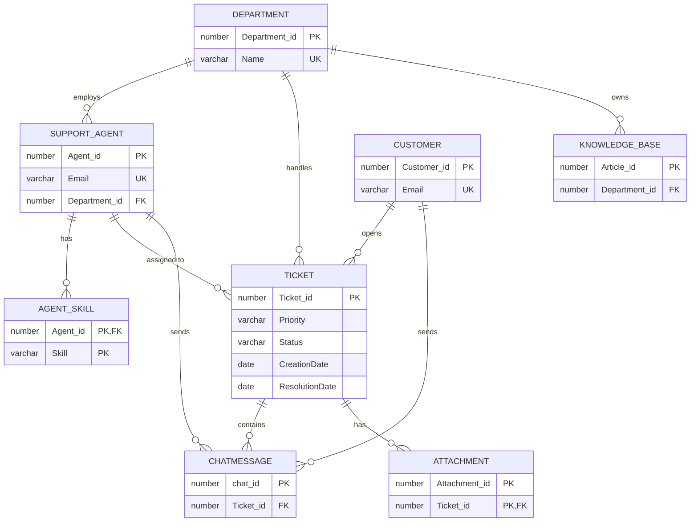

# Helpdesk Ticketing Database

A relational database for an internal helpdesk: customers open tickets, tickets are routed to departments and assigned to support agents, and each ticket keeps its chat messages and attachments. A knowledge base stores help articles per department. Built in **Oracle SQL** as a university database course project.

## Entity–relationship diagram



## Design highlights

- **8 tables** with primary keys, foreign keys, and `UNIQUE` emails and department names
- **Data-quality rules with `CHECK` constraints:**
  - every customer and agent must have a phone **or** an email
  - phones start with `05` and emails follow `x@y.z`
  - ticket `Priority` is Low / Medium / High and `Status` is Open / In Progress / Closed
  - a ticket cannot be resolved before it was created
  - each chat message is sent by **exactly one** party: an agent or a customer, never both
- **Cascading rules:** deleting a ticket removes its attachments; deleting an agent removes their skills; deleting an agent or customer keeps their messages but clears the sender (`ON DELETE SET NULL`)
- **Composite keys** for agent skills and ticket attachments

## Views and reports

| View | Shows |
|---|---|
| `Open_Tickets_View` | open tickets with customer and department |
| `Ticket_Summary_View` | every ticket with customer, department and assigned agent |
| `Ticket_Activity_View` | message and attachment counts per ticket |
| `View_Attachments_By_Ticket` | attachments per ticket |
| `Knowledge_By_Department_View` | knowledge-base articles by department |

Plus aggregate queries: tickets per customer, per priority and per department, attachments by file type, and closed tickets by resolution date.

## Files

| File | Contents |
|---|---|
| [`sql/01_schema.sql`](sql/01_schema.sql) | `CREATE TABLE` statements and constraints |
| [`sql/02_seed_data.sql`](sql/02_seed_data.sql) | sample departments, agents, customers, tickets, messages, attachments and articles |
| [`sql/03_views_and_queries.sql`](sql/03_views_and_queries.sql) | views and analytics queries |

## How to run

Run the three files in order in Oracle (SQL Developer, SQL*Plus or Oracle Live SQL):

```sql
@sql/01_schema.sql
@sql/02_seed_data.sql
@sql/03_views_and_queries.sql
```

## Team

University team project. **My contribution:** co-designed the schema and constraints, and wrote views and reporting queries.
